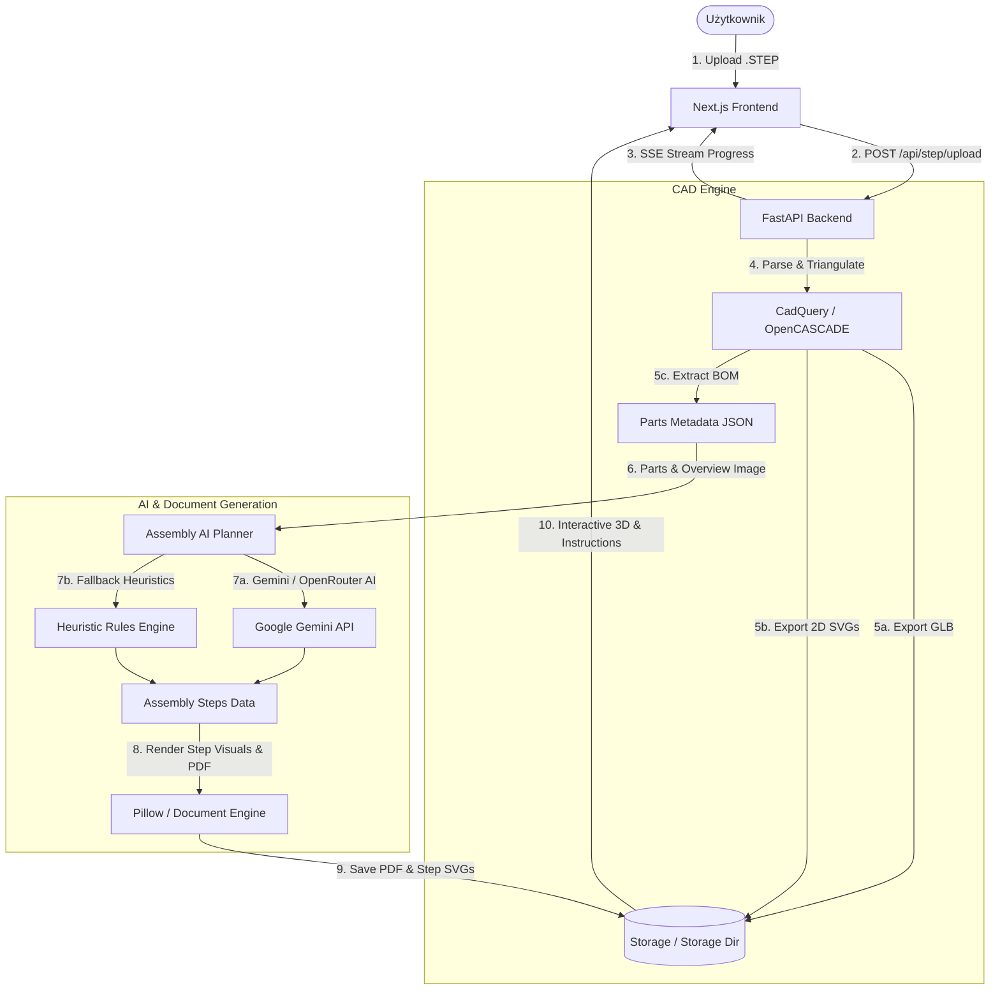

# AutoAssembly AI 🛠️🤖
### Automated CAD STEP Processing, 3D Interactive Visualization & AI-Driven Assembly Instructions


**AutoAssembly AI** to zaawansowane narzędzie webowe typu Open-Source przeznaczone do automatycznego przetwarzania modeli CAD (pliki `.step` / `.stp`), ich rozbijania na komponenty (BOM), generowania trójwymiarowych modeli interaktywnych (`.glb`) oraz tworzenia **instrukcji montażu krok po kroku w stylu IKEA** przy użyciu sztucznej inteligencji (Google Gemini) z eksportem do formatu PDF.

---

## 🌟 Główne Funkcje (Features)

- 📐 **Parsowanie geometrii CAD 3D**: Bezpośredni odczyt i przetwarzanie plików w formacie `.step` / `.stp` za pomocą silnika OpenCASCADE / CadQuery.
- 📦 **Automatyczne zestawienie materiałów (BOM)**: Klasyfikacja części na panele konstrukcyjne, łączniki oraz inne komponenty z automatycznym grupowaniem obiektów bliźniaczych.
- 🖼️ **Wektorowe rzuty 2D**: Generowanie rysunków technicznych SVG dla każdej unikalnej części.
- 🌐 **Interaktywny Podgląd 3D (Web Viewer)**: Wizualizacja modelu na żywo przy użyciu Three.js / React Three Fiber z płynnym **suwakiem widoku rozstrzelonego (Exploded View)**.
- 🤖 **Inteligentny Planista Montażu (AI Assembly Planner)**: Wykorzystanie LLM (Google Gemini / OpenRouter) do analizy układu geometrycznego i generowania logicznej kolejności składania.
- ⚡ **Odporność na błędy (Heuristic Fallback)**: Automatyczne przełączenie na wbudowany moduł heurystyczny w przypadku braku klucza API lub awarii połączenia sieciowego.
- 📄 **Generowanie Instrukcji PDF & SVG**: Tworzenie profesjonalnych podręczników montażowych krok po kroku oraz plakatów zestawieniowych gotowych do druku.
- 🔄 **Real-Time Progress Streaming**: Transmisja statusu przetwarzania w czasie rzeczywistym poprzez Server-Sent Events (SSE).

---

## 🏗️ Architektura Systemu



---

## 🛠️ Stos Technologiczny

### **Backend**
- **Python 3.10+**
- **FastAPI** – Asynchroniczne API REST & SSE
- **CadQuery & OpenCASCADE** – Silnik przetwarzania geometrii CAD
- **Google Generative AI SDK / OpenRouter API** – Generowanie planów montażu AI
- **Pillow (PIL)** – Renderer widoków 2D oraz generator dokumentów PDF

### **Frontend**
- **Next.js 16 (App Router)** & **React 19**
- **Three.js** & **@react-three/fiber / @react-three/drei** – WebGL / Podgląd 3D
- **Tailwind CSS v4** & **Lucide Icons** – Modern UI z ciemnym motywem

---

## 🚀 Szybki Start (Getting Started)

### Wymagania wstępne
* Python `3.10` lub nowszy
* Node.js `18.0` lub nowszy
* Klucz API Google Gemini (opcjonalnie)

---

### 1️⃣ Konfiguracja Backendu

```powershell
# 1. Przejdź do głównego katalogu
cd CAD-assembly-generator

# 2. Utwórz i aktywuj środowisko wirtualne
python -m venv backend/venv
.\backend\venv\Scripts\Activate.ps1

# 3. Zainstaluj zależności Pythona
pip install -r backend/requirements.txt

# 4. Skonfiguruj zmienne środowiskowe
cp backend/.env.example backend/.env

# 5. Uruchom serwer API
python -m uvicorn backend.main:app --reload --port 8000
```
> API będzie dostępne pod adresem: `http://127.0.0.1:8000` (Dokumentacja Swagger: `http://127.0.0.1:8000/docs`).

---

### 2️⃣ Konfiguracja Frontendu

Otwórz nowy terminal:

```powershell
# 1. Przejdź do katalogu frontend
cd CAD-assembly-generator/frontend

# 2. Zainstaluj pakiety Node.js
npm install

# 3. Uruchom serwer deweloperski Next.js
npm run dev
```
> Interfejs użytkownika będzie dostępny w przeglądarce pod adresem: **`http://localhost:3000`**.

---

## 🔑 Konfiguracja `.env`

W pliku `backend/.env` możesz skonfigurować wybranego dostawcę AI:

```env
ASSEMBLY_AI_PROVIDER=gemini
GEMINI_API_KEY=your_google_gemini_api_key
GEMINI_MODEL=gemini-2.0-flash

# Opcjonalnie: dostawca OpenRouter
OPENROUTER_API_KEY=
OPENROUTER_MODEL=google/gemini-2.5-flash-preview
```

---

## 🧪 Testy End-to-End (E2E)

W projekcie znajduje się skrypt PowerShell do automatycznego testowania pełnej ścieżki przetwarzania pliku CAD:

```powershell
.\scripts\run-e2e-test.ps1 -StepFile "sciezka\do\pliku.step"
```
Skrypt automatycznie uruchamia backend i frontend, wgrywa model STEP, oczekuje na zakończenie transmisji SSE, testuje generowanie AI oraz weryfikuje pobieranie pliku PDF.

---

## 📡 API Endpoints Summary

| Metoda | Endpoint | Opis |
| :--- | :--- | :--- |
| `POST` | `/api/step/upload` | Wgrywa plik `.step` i inicjuje zadanie przetwarzania |
| `GET` | `/api/step/progress/{job_id}/stream` | Streamuje postęp przetwarzania via SSE |
| `POST` | `/api/assembly/generate/{job_id}` | Uruchamia generowanie instrukcji montażu przez AI |
| `GET` | `/api/assembly/instructions/{job_id}` | Pobiera dane z historią wygenerowanej instrukcji |
| `GET` | `/api/assembly/pdf/{job_id}` | Pobiera gotowy plik instrukcji w formacie PDF |
| `GET` | `/api/files/{filename}` | Statyczny dostęp do plików modeli GLB, SVG, PNG i PDF |

---

## 📜 Licencja

Projekt udostępniany jest na licencji **MIT**. Szczegóły znajdują się w pliku `LICENSE`.
