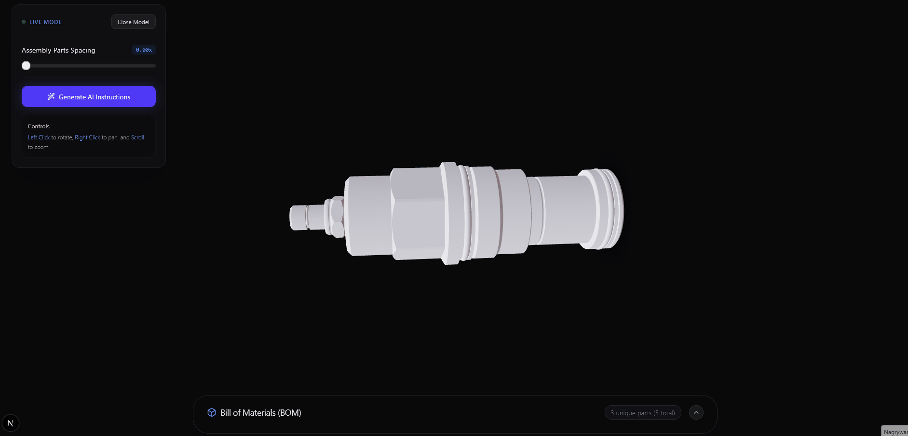
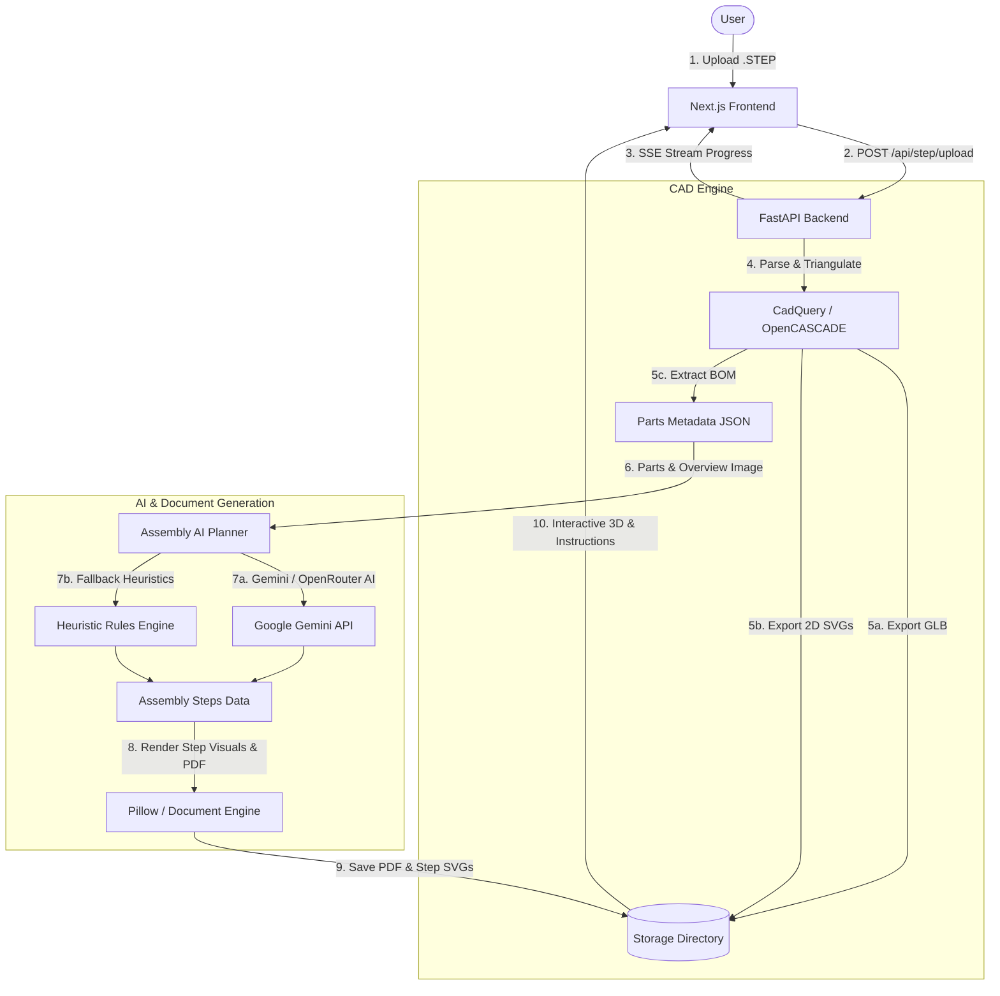

# AutoAssembly AI 🛠️🤖
### Automated CAD STEP Processing, 3D Interactive Visualization & AI-Driven Assembly Instructions

<div align="center">

[](LICENSE)
[](https://github.com/MarceliKarman/AutoAssembly-AI/actions/workflows/ci.yml)
[](https://www.python.org/)
[](https://fastapi.tiangolo.com/)
[](https://nextjs.org/)
[](https://threejs.org/)
[](https://ai.google.dev/)

</div>

---

## 🎥 Preview & Demo

<div align="center">
  
  <p><em>Real-time CAD STEP parsing, 3D WebGL exploded view manipulation, parts cataloging, and automated step-by-step assembly generation.</em></p>
</div>

---

**AutoAssembly AI** is an open-source web application designed to automatically parse CAD assembly models (`.step` / `.stp` files), extract individual parts and Bill of Materials (BOM), generate interactive 3D WebGL models (`.glb`), and create **IKEA-style step-by-step assembly manuals** using Large Language Models (Google Gemini) with full PDF export capabilities.

---

## 🌟 Key Features

- 📐 **3D CAD Geometry Parsing**: Direct reading and processing of `.step` / `.stp` files powered by OpenCASCADE and CadQuery.
- 📦 **Automated Bill of Materials (BOM)**: Intelligent part classification (panels, connectors, structural parts) with duplicate instance grouping and dimensions.
- 🖼️ **Vector 2D Blueprints**: Automatic generation of clean SVG technical drawings for every unique component.
- 🌐 **Interactive 3D Web Viewer**: Real-time WebGL visualization powered by Three.js / React Three Fiber featuring an interactive **Exploded View Slider**.
- 🤖 **AI Assembly Planner**: Leveraging Multimodal LLMs (Google Gemini / OpenRouter) to analyze spatial layouts and formulate step-by-step assembly sequences.
- ⚡ **Fault-Tolerant Fallback**: Automatic failover to an in-house heuristic rules engine if AI API keys are unavailable or network calls fail.
- 📄 **PDF & SVG Document Generator**: Dynamic creation of printable multi-page assembly manuals and step-by-step vector highlights.
- 🔄 **Real-Time Progress Streaming**: Live job progress updates via Server-Sent Events (SSE).

---

## 🏗️ System Architecture



---

## 🛠️ Tech Stack

### **Backend**
- **Python 3.10+**
- **FastAPI** – Async REST API & Server-Sent Events (SSE)
- **CadQuery & OpenCASCADE** – CAD geometry kernel and 3D processing
- **Google Generative AI SDK / OpenRouter API** – Multimodal LLM assembly sequence planning
- **Pillow (PIL)** – 2D vector/raster rendering and multi-page PDF generation

### **Frontend**
- **Next.js 16 (App Router)** & **React 19**
- **Three.js** & **@react-three/fiber / @react-three/drei** – WebGL 3D model viewport
- **Tailwind CSS v4** & **Lucide Icons** – Modern dark-mode UI

---

## 🚀 Quick Start

### Prerequisites
* Python `3.10` or higher
* Node.js `18.0` or higher (Node 20+ recommended)
* Google Gemini API Key (Optional — built-in heuristic fallback works out of the box)

---

### 1️⃣ Backend Setup

```powershell
# 1. Navigate to the project root
cd AutoAssembly-AI

# 2. Create and activate a virtual environment
python -m venv backend/venv
.\backend\venv\Scripts\Activate.ps1

# 3. Install Python dependencies
pip install -r backend/requirements.txt

# 4. Configure environment variables (optional)
cp backend/.env.example backend/.env

# 5. Start the FastAPI server
python -m uvicorn backend.main:app --reload --port 8000
```
> The API will be running at `http://127.0.0.1:8000` (Swagger UI: `http://127.0.0.1:8000/docs`).

---

### 2️⃣ Frontend Setup

In a new terminal window:

```powershell
# 1. Navigate to the frontend directory
cd AutoAssembly-AI/frontend

# 2. Install Node.js packages
npm install

# 3. Start the Next.js development server
npm run dev
```
> The web application will be accessible at **`http://localhost:3000`**.

---

## 🔑 Environment Variables (`.env`)

Configure your preferred AI provider in `backend/.env`:

```env
ASSEMBLY_AI_PROVIDER=gemini
GEMINI_API_KEY=your_google_gemini_api_key
GEMINI_MODEL=gemini-2.0-flash

# Optional: OpenRouter Provider
OPENROUTER_API_KEY=
OPENROUTER_MODEL=google/gemini-2.5-flash-preview
```

---

## 🧪 Testing & Verification

### Automated Backend Tests (Unit Tests)
The repository includes a comprehensive 32-test unit test suite covering classification, AI prompt creation, document generators, job management, and API endpoints:

```powershell
# Run the test suite from the project root
$env:PYTHONPATH="."
.\backend\venv\Scripts\python -m unittest discover -s backend/tests -v
```

### End-to-End (E2E) Pipeline Script
A PowerShell script is provided to test the full CAD-to-PDF processing pipeline end-to-end:

```powershell
.\scripts\run-e2e-test.ps1
```
The script handles port listener cleanups, launches background servers, uploads the CAD file, verifies SSE progress streams, triggers AI instruction generation, and validates PDF downloads.

### Continuous Integration (CI)
GitHub Actions workflow is set up in `.github/workflows/ci.yml` running linting, typechecking, frontend build, Python compilation, and all unit tests on every pull request and push to `main`.

---

## 📡 API Endpoints Summary

| Method | Endpoint | Description |
| :--- | :--- | :--- |
| `POST` | `/api/step/upload` | Upload a `.step` file and create a processing job |
| `GET` | `/api/step/progress/{job_id}/stream` | Stream job progress via Server-Sent Events (SSE) |
| `POST` | `/api/assembly/generate/{job_id}` | Trigger AI/heuristic assembly manual generation |
| `GET` | `/api/assembly/instructions/{job_id}` | Fetch generated instruction metadata |
| `GET` | `/api/assembly/pdf/{job_id}` | Download generated PDF assembly manual |
| `GET` | `/api/files/{filename}` | Static asset server for GLB, SVG, PNG, and PDF files |

---

## 📜 License

This project is licensed under the **MIT License**. See the `LICENSE` file for details.
